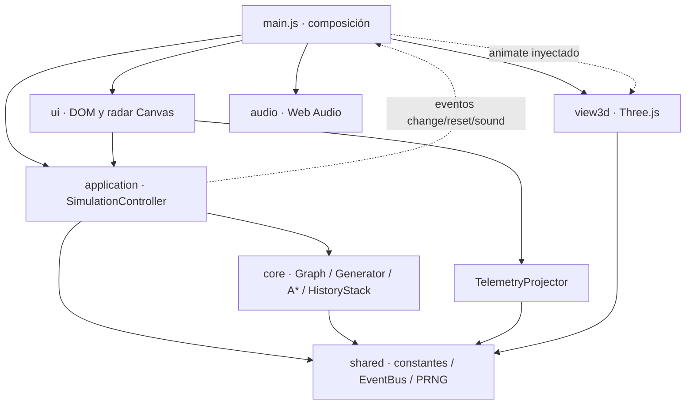
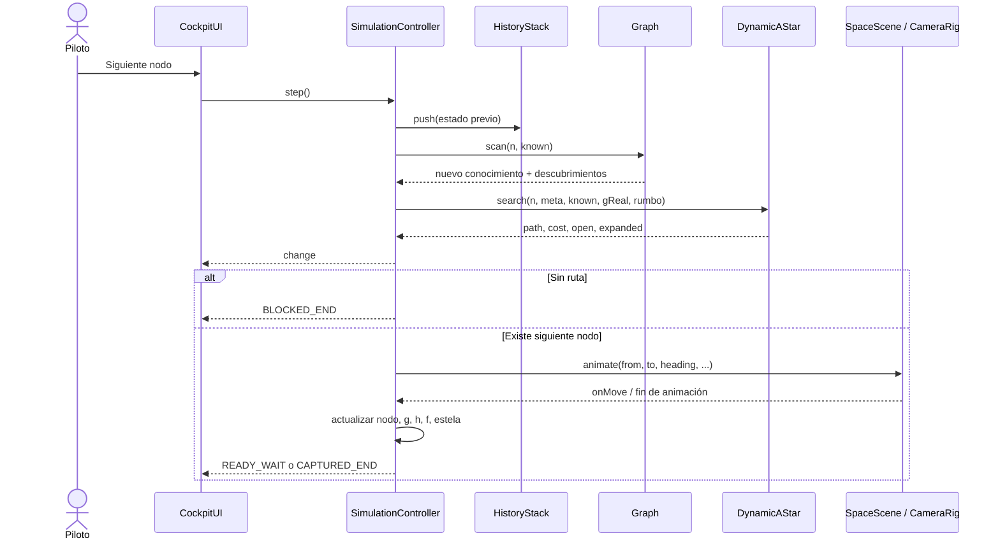

# Arquitectura y organización

## Capas y dependencias

El proyecto usa módulos ES nativos. El dominio trabaja con números, arrays y objetos JavaScript; no importa DOM, Three.js ni Web Audio. La aplicación coordina los pasos y recibe una función de animación inyectada. La presentación traduce el estado lógico en instrumentos, sonido y movimientos visibles.



El diagrama representa dependencias y conexiones de ejecución relevantes, no importaciones exhaustivas. `EventBus` pertenece a la instancia del controlador. `main.js` conecta eventos con la escena y el sintetizador; la UI se suscribe al controlador.

## Inventario de módulos

| Ubicación                                                             | Responsabilidad                                                                                               |
| --------------------------------------------------------------------- | ------------------------------------------------------------------------------------------------------------- |
| [index.html](../index.html)                                           | Estructura del visor, cinco MFD, controles, selector móvil y diálogo.                                         |
| [main.js](../src/main.js)                                             | Leer URL, construir dependencias, inyectar animación, enlazar audio, reiniciar misión y exponer diagnósticos. |
| [constants.js](../src/shared/constants.js)                            | Dimensiones, tipos, fases, cardinales y conversiones de coordenadas.                                          |
| [Random.js](../src/shared/Random.js)                                  | PRNG determinista a partir de texto.                                                                          |
| [EventBus.js](../src/shared/EventBus.js)                              | Registro de listeners y emisión síncrona.                                                                     |
| [Graph.js](../src/core/Graph.js)                                      | Mundo inmutable, vecindad, costes y conocimiento inicial/escaneo.                                             |
| [Generator.js](../src/core/Generator.js)                              | Distribución de celdas, fronteras, balizas y corredor.                                                        |
| [DynamicAStar.js](../src/core/DynamicAStar.js)                        | Heap interno, búsqueda optimista, reconstrucción y frontera resumida.                                         |
| [HistoryStack.js](../src/core/HistoryStack.js)                        | Clonar, congelar y recuperar snapshots.                                                                       |
| [SimulationController.js](../src/application/SimulationController.js) | Replanificación repetida, ejecución de pasos, coste real, reversa, historial y piloto.                        |
| [TelemetryProjector.js](../src/application/TelemetryProjector.js)     | Derivar coordenadas, bioma, rumbo y cuatro vecinos para presentación.                                         |
| [CockpitUI.js](../src/ui/CockpitUI.js)                                | MFD, bitácora, controles, teclado, selección móvil y mensajes.                                                |
| [TacticalRadar.js](../src/ui/TacticalRadar.js)                        | Dibujo 2D, ruta, conocimiento, estela, balizas y tooltip.                                                     |
| [icons.js](../src/ui/icons.js)                                        | Iconos SVG locales de controles.                                                                              |
| [SpaceScene.js](../src/view3d/SpaceScene.js)                          | Escena, renderer, luces, calidad, visibilidad de peligros y ciclo de render.                                  |
| [PilotCameraRig.js](../src/view3d/PilotCameraRig.js)                  | Coordenadas de mundo, interpolación, guiñada, avance y regreso visual.                                        |
| [Cockpit.js](../src/view3d/Cockpit.js)                                | Estructura física de cabina unida a la cámara.                                                                |
| [Spacecraft.js](../src/view3d/Spacecraft.js)                          | Modelo de la nave fugitiva.                                                                                   |
| [Biomes.js](../src/view3d/Biomes.js)                                  | Planeta, nubes, atmósfera, cielo, estrellas y decorado ambiental.                                             |
| [Obstacles.js](../src/view3d/Obstacles.js)                            | Rocas, anomalías, singularidades, balizas y liberación de grupos.                                             |
| [SurfaceTextures.js](../src/view3d/SurfaceTextures.js)                | Ruido, texturas procedurales y carga de mapas locales.                                                        |
| [Synthesizer.js](../src/audio/Synthesizer.js)                         | Contexto de audio, osciladores, envolventes y motivos de eventos.                                             |

## Estructura de disco

```text
astar/
├── index.html
├── package.json / package-lock.json
├── vite.config.js
├── README.md / CHANGELOG.md / CONTRIBUTING.md
├── docs/
├── css/
│   ├── variables.css
│   ├── cockpit-layout.css
│   └── mfd-screens.css
├── public/
│   ├── favicon.svg
│   ├── textures/
│   └── licenses/
├── src/
│   ├── shared/ core/ application/
│   ├── view3d/ ui/ audio/
│   └── main.js
└── tests/
```

`node_modules/`, `dist/`, `.vite/`, resultados de Playwright y logs son salidas locales ignoradas. `public/` contiene recursos que deben acompañar al build; no es un servicio externo.

## Inicialización

1. Vite carga el HTML y `main.js`.
2. Se interpretan `seed`, `blocked` y `quality`.
3. El controlador genera el mundo, el conocimiento inicial y el primer plan; nace en `BOOT_INTRO`.
4. La UI recibe el estado y prepara radar, monitores y controles.
5. Se crea la escena, se materializa lo conocido y se conecta `animate` con `PilotCameraRig.fly`.
6. Se enlazan cambios/reinicios con la vista y sonidos con el sintetizador.
7. El temporizador de arranque solicita `ready()`; la partida queda en espera.

El temporizador de arranque no es una promesa de que todas las texturas ya hayan terminado de cargar. La suite de navegador espera además la actividad inicial de red. La carga y recuperación de recursos puede consolidarse como mejora de robustez.

## Flujo de un paso



En movimiento reducido, la animación posiciona directamente la cámara y el flujo lógico conserva el mismo orden. La simulación sin vista usa por defecto una animación asíncrona vacía.

## Tres representaciones distintas

| Representación | Propietario   | Regla                                                           |
| -------------- | ------------- | --------------------------------------------------------------- |
| Mundo real     | `Graph.cells` | Inmutable durante una misión.                                   |
| Mundo conocido | `state.known` | Revela lo escaneado; puede retroceder al deshacer.              |
| Presentación   | Escena y DOM  | Se deriva del estado; no decide transitabilidad ni combustible. |

El decorado espacial no constituye un obstáculo lógico. Una posición visual del fugitivo durante captura o warp tampoco cambia la coordenada de la meta.

## Reversibilidad y concurrencia

Solo los snapshots de historial se congelan profundamente. El estado activo del controlador es mutable y los eventos lo entregan por referencia: los listeners deben tratarlo como de solo lectura. La API de diagnóstico devuelve una copia.

`busy` impide intercalar avance, regreso o reset durante una operación. El piloto programa otro paso después de finalizar el actual. Deshacer detiene la automatización y restaura el estado, sin escanear de nuevo.

La atomicidad descrita es la de un comando de simulación. No existe una transacción con rollback automático frente a cualquier excepción del renderer o listener. Esa robustez adicional figura en los [pendientes](ESTADO_Y_OBJETIVOS.md).

## Límites arquitectónicos actuales

- A\* reconstruye sus estructuras en cada búsqueda; no es un planificador incremental que reutilice OPEN/CLOSED entre pasos.
- La UI conoce el controlador concreto; no hay contenedor de inyección ni interfaces TypeScript.
- `Graph` verifica la longitud del array, pero no sustituye una validación completa de datos importados.
- No hay backend ni API REST que documentar. Los contratos existentes son módulos y eventos del cliente.
- Los MFD son DOM/CSS; una interfaz espacial WebXR necesitaría otro adaptador.

[Índice](README.md) · [Contratos internos](ESTADO_Y_API.md)
