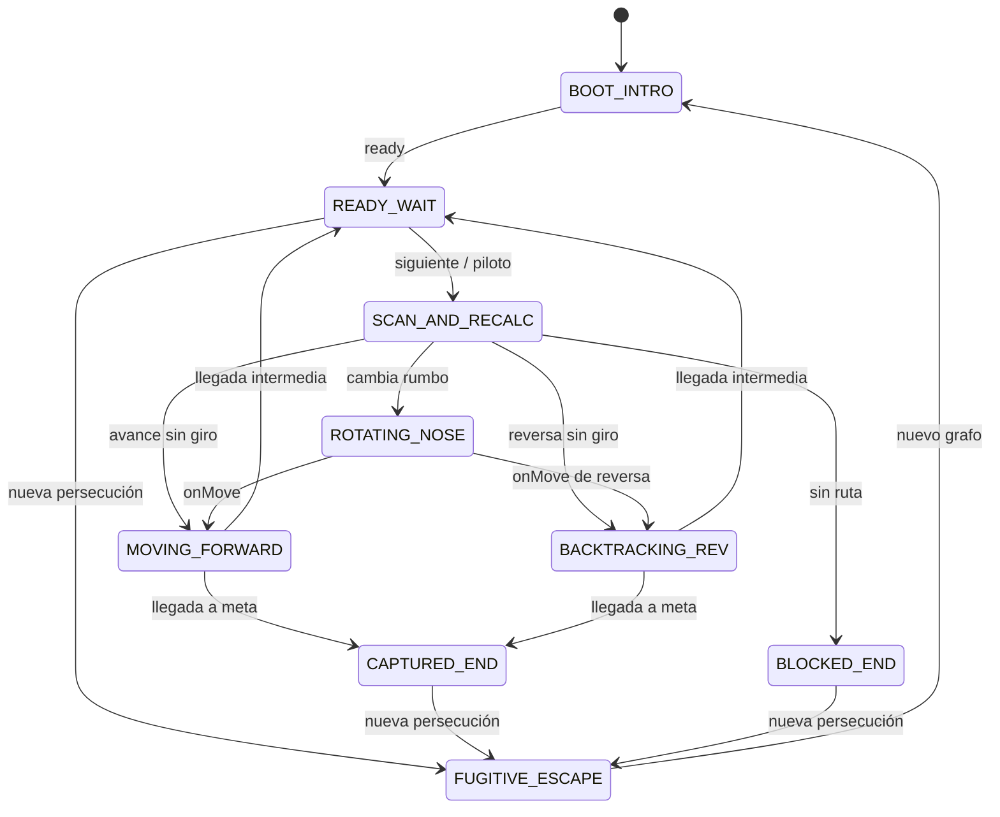

# Estado, máquina de vuelo y API interna

Estos contratos son módulos del cliente, no endpoints HTTP. No hay una API pública versionada para integraciones externas. Los ejemplos de motor se ejecutan desde la raíz del repositorio con Node moderno.

## Identificadores y tipos

```text
// Formas conceptuales; el proyecto está escrito en JavaScript, no TypeScript.
NodeId = number; // entero 0..335
Heading = { dx: -1 | 0 | 1, dz: -1 | 0 | 1 }; // vector cardinal unitario
CellType = 'clear' | 'anomaly' | 'solid' | 'gate' | 'wormhole';
KnownCell = CellType | null;
```

Los consumidores deben proporcionar IDs válidos, arrays de 336 celdas y vectores cardinales. Las funciones internas no validan exhaustivamente cada dato; importar mapas no confiables requerirá un validador adicional.

## Estado de simulación

| Campo            | Forma              | Semántica                                                                      |
| ---------------- | ------------------ | ------------------------------------------------------------------------------ |
| `seed`           | string             | Semilla de la misión.                                                          |
| `blocked`        | boolean            | Generación con meta encerrada.                                                 |
| `phase`          | string de `PHASES` | Etiqueta de estado de vuelo.                                                   |
| `node`           | NodeId             | Nodo lógico actual.                                                            |
| `heading`        | Heading            | Vector de la nariz, independiente del vector de reversa.                       |
| `g`, `h`, `f`    | number             | Coste real, Manhattan y suma para la posición actual.                          |
| `step`           | number             | Movimientos completados.                                                       |
| `recalculations` | number             | Pulsos con nuevos sólidos o anomalías.                                         |
| `known`          | KnownCell[336]     | Conocimiento del piloto.                                                       |
| `route`          | NodeId[]           | Plan actual, comenzando en el nodo actual tras completar el paso.              |
| `open`           | Candidate[]        | Hasta seis candidatos restantes de la última búsqueda.                         |
| `expanded`       | number             | Tamaño de CLOSED al finalizar esa búsqueda; no un acumulado de toda la misión. |
| `ancestry`       | NodeId[]           | Rama activa usada para reconocer el nodo padre.                                |
| `trail`          | NodeId[]           | Todas las visitas de la partida, incluyendo repeticiones.                      |
| `discarded`      | NodeId[]           | IDs únicos de nodos abandonados mediante reversa.                              |
| `reverseCount`   | number             | Desplazamientos clasificados como reversa.                                     |
| `events`         | EventEntry[]       | Hasta 70 eventos, el más reciente primero.                                     |
| `report`         | Report o null      | Solo se completa al capturar.                                                  |

```text
Candidate = { id, g, h, f, inertia, order };
EventEntry = { step, tone, text };
Report = { optimalCost, optimalPath, actualCost, overhead, steps };
```

`inertia` es 0 para continuar el rumbo recibido y 1 para otra dirección. `order` estabiliza empates. Los tonos de bitácora utilizados son `info`, `warning`, `danger` y `success`.

Durante una transición, la rama y el plan pueden haberse preparado para el siguiente nodo mientras `node` y g aún representan la salida. La actualización de posición y combustible se completa después de la animación; evalúa invariantes de un paso terminado cuando resuelve `step()`, no a partir de cualquier evento intermedio.

## Máquina de estados



| Fase               | Efecto principal                                           |
| ------------------ | ---------------------------------------------------------- |
| `BOOT_INTRO`       | Grafo y plan inicial preparados; presentación de arranque. |
| `READY_WAIT`       | Espera de un comando; se puede automatizar.                |
| `SCAN_AND_RECALC`  | Revelación local y ejecución del planificador.             |
| `ROTATING_NOSE`    | Giro visual previo al desplazamiento.                      |
| `MOVING_FORWARD`   | Traslación de avance.                                      |
| `BACKTRACKING_REV` | Traslación con nariz opuesta al movimiento.                |
| `CAPTURED_END`     | Captura, coste de referencia y efecto tractor.             |
| `BLOCKED_END`      | Búsqueda agotada; se detiene el piloto.                    |
| `FUGITIVE_ESCAPE`  | Presentación del reinicio antes de generar otra misión.    |

El diagrama describe el flujo normal. `undo()` puede restaurar cualquier fase previamente guardada. Los nombres de fase no constituyen un autómata formal con tabla de transiciones validada: `setPhase()` asigna la etiqueta y emite un cambio. `step()` también puede aceptar `BOOT_INTRO` si se llama antes del temporizador de `ready()`. Con movimiento reducido, varias fases pueden ocurrir sin un fotograma intermedio visible.

## Graph

```js
new Graph(cells, start, goal, (beacons = []), (sectorWalls = []));
graph.neighbors(id); // NodeId[] de vecinos válidos
graph.cost(id, (known = graph.cells)); // 1, 2 o Infinity
graph.initialKnowledge(); // nuevo array de 336 entradas
graph.scan(id, known); // { known, discoveries }
```

El constructor copia y congela arrays y objeto; rechaza longitudes distintas de 336. `scan` conserva el array recibido y devuelve otro. Cada descubrimiento es `{ id, type }`. `generateGraph(seed, blocked = false)` devuelve una instancia ya preparada.

## DynamicAStar

```js
solver.search(graph, start, goal, known, (initialG = 0), (heading = { dx: 1, dz: 0 }));
// -> { path, cost, expanded, open }
```

| Resultado         | `path`                 | `cost`                             | `open`                                   |
| ----------------- | ---------------------- | ---------------------------------- | ---------------------------------------- |
| Camino encontrado | Incluye inicio y meta. | g de llegada, incluido `initialG`. | Resumen restante, hasta seis candidatos. |
| Sin camino        | `[]`                   | `Infinity`                         | `[]`                                     |

`MinHeap` es una clase interna sin exportación. El nombre `DynamicAStar` no significa que implemente D\* Lite ni conservación incremental de las estructuras entre llamadas.

## HistoryStack y StepSnapshot

```js
history.push(state); // structuredClone + congelación profunda
history.peek(); // última copia congelada, o undefined
history.pop(); // nueva copia mutable, o null
history.clear();
history.size; // cantidad de snapshots
```

`StepSnapshot` es el concepto de estado completo guardado; no hay una clase con ese nombre en el código. El snapshot se toma **antes del escaneo del comando**. Un intento que termina en bloqueo también conserva su snapshot, aunque no complete un desplazamiento.

No se guardan el grafo completo, velocidad, audio, calidad, timers, `busy` ni la bandera `auto`. El grafo no necesita duplicarse porque no cambia durante la misión. Al deshacer se detiene el piloto y se conservan los ajustes de presentación actuales. Una nueva misión vacía el historial.

## SimulationController

```js
new SimulationController(({ seed = 'ORION-042', blocked = false, animate = async () => {} } = {}));
```

| Miembro                            | Contrato                                                                                          |
| ---------------------------------- | ------------------------------------------------------------------------------------------------- |
| `state`, `graph`, `history`, `bus` | Estado y servicios de la instancia; no modificarlos desde la vista.                               |
| `speed`                            | Factor de velocidad; la UI ofrece 0.65, 1, 2 y 4.                                                 |
| `busy`, `auto`                     | Indicadores de ejecución; quedan fuera del snapshot.                                              |
| `step()`                           | Promise de boolean. Rechaza comandos incompatibles; ejecuta escaneo, plan y movimiento o bloqueo. |
| `undo()`                           | Promise de boolean. Devuelve false si no puede recuperar un snapshot.                             |
| `reset(seed, blocked = false)`     | Devuelve false si está ocupado. En otro caso crea la misión y emite reset/change.                 |
| `ready()`                          | Lleva BOOT_INTRO o FUGITIVE_ESCAPE a READY_WAIT.                                                  |
| `toggleAuto()`                     | Alterna la ejecución programada; la pausa permite concluir el paso en curso.                      |
| `stopAuto()`                       | Desactiva la bandera y cancela el próximo timeout. No corta un paso ya iniciado.                  |
| `setPhase(phase)`, `emit()`        | Utilidades de coordinación; no validan una tabla formal de estados.                               |

La UI orquesta la cinemática de nueva persecución antes de llamar a `reset`; invocar `reset` directamente no reproduce el warp ni modifica la URL.

### Puerto de animación

```js
await animate({
  from,
  to,
  heading,
  reverse,
  turning,
  speed,
  onMove,
  undo /* solo durante regreso */,
});
```

La función debe resolver cuando termina la operación visual y llamar a `onMove()` al comenzar su traslación. Durante `undo`, ese callback es vacío. El controlador contabiliza la entrada después de esperar la animación del avance. Una animación rechazada no tiene rollback completo automático: debe tratarse como un error que requiere diagnóstico.

## Eventos

`EventBus.on(nombre, listener)` devuelve una función para desuscribirse. `emit` llama listeners síncronamente; no los aísla mediante try/catch ni espera Promises.

| Evento    | Payload                                               | Uso                                                                                           |
| --------- | ----------------------------------------------------- | --------------------------------------------------------------------------------------------- |
| `change`  | Referencia al estado activo.                          | Sincronizar UI y escena.                                                                      |
| `reset`   | Referencia al nuevo estado.                           | Reconstruir elementos dependientes del grafo.                                                 |
| `sound`   | `scan`, `obstacle`, `reverse`, `capture` o `blocked`. | Motivos del controlador; `warp` se invoca directamente desde main, sin pasar por este evento. |
| `gesture` | Sin payload requerido.                                | Solicitar desbloqueo de audio tras una interacción.                                           |
| `error`   | Error                                                 | Detener automatización y mostrar diagnóstico.                                                 |

`busy` vuelve a false en los bloques `finally` de paso/regreso. Los listeners de cambio deben leer el estado, no mutarlo.

## TelemetryProjector

`projectTelemetry(state, graph)` devuelve `position`, `biome`, `sector`, `heading`, `progress`, `discovered` y `neighbors`.

Cada vecino contiene `name`, `id` o null, `type`, `cost`, `selected` y `goal`. Un vecino fuera del mapa tiene coste infinito; uno desconocido se presenta con `?`. El progreso derivado usa la distancia inicial 22: no está generalizado a otros orígenes/metas y no gobierna la captura.

## Ejemplo ejecutable sin navegador

```js
import { SimulationController } from './src/application/SimulationController.js';

const sim = new SimulationController({ seed: 'ORION-042' });
sim.ready();
await sim.step();
console.log(sim.state.step, sim.state.g); // 1, 1
await sim.undo();
console.log(sim.state.step, sim.state.g); // 0, 0
```

Puede ejecutarse con `node --input-type=module` y entrada estándar, o desde un archivo `.js` situado en la raíz.

## Diagnóstico en navegador

```js
window.orion.getSnapshot(); // structuredClone del estado
window.orion.getStatus(); // { busy, auto, history, webgl, quality }
```

La fachada está congelada y no expone comandos mutadores. `webgl` indica que se creó la escena; por sí solo no prueba todos los shaders ni la recuperación de contexto. Los tests lo complementan con acciones funcionales y captura de errores de consola.

[Índice](README.md) · [Arquitectura](ARQUITECTURA.md)
