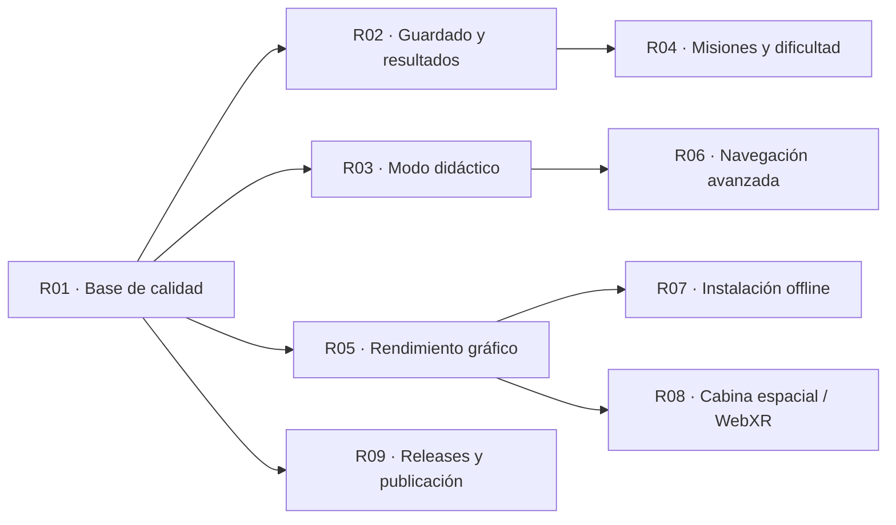

# Roadmap y sugerencias para crear

Este documento propone trabajo futuro. **Ninguna función se considera implementada por aparecer aquí.** Los pendientes actuales y su evidencia están en [Estado y objetivos](ESTADO_Y_OBJETIVOS.md). No se asignan fechas ni responsables personales.

## Orden recomendado



Las flechas indican dependencias recomendadas, no obligaciones técnicas universales. Empezaría por **CI y validación**, después **exportación/guardado** y **modo didáctico**: hacen la experiencia más confiable y útil sin cambiar las reglas centrales.

| ID  | Propuesta                                      | Prioridad              | Esfuerzo relativo | Valor principal                               |
| --- | ---------------------------------------------- | ---------------------- | ----------------- | --------------------------------------------- |
| R01 | Base de calidad, accesibilidad y recuperación  | Alta                   | Medio             | Confiabilidad de cada entrega.                |
| R02 | Guardado, exportación e informes reproducibles | Alta                   | Medio             | Continuar, estudiar y compartir experimentos. |
| R03 | Laboratorio didáctico de algoritmos            | Alta                   | Medio/grande      | Explicar decisiones, no solo su resultado.    |
| R04 | Catálogo de misiones, semilla y dificultad     | Media                  | Medio             | Repetición guiada y variedad controlada.      |
| R05 | Presupuestos gráficos y calidad adaptativa     | Alta                   | Medio/grande      | Consistencia entre equipos.                   |
| R06 | Planificadores incrementales y mundo cambiante | Exploratoria           | Grande            | Investigar navegación avanzada.               |
| R07 | PWA y offline explícito                        | Media                  | Medio             | Distribución local e instalación.             |
| R08 | MFD espaciales e interacción inmersiva         | Exploratoria           | Grande            | Profundizar la experiencia de cabina.         |
| R09 | Releases, licencia y hosting                   | Alta para distribución | Pequeño/medio     | Entrega identificable y accesible.            |

El esfuerzo es comparativo, no una estimación en días; deberá revisarse después de diseñar cada tarea.

## R01 · Crear una base de calidad

**Estado:** propuesto; consolida P01, P02, P03, P05 y P10.

Crear un workflow que prepare Node y un Chromium conocido, ejecute dominio/build/E2E y conserve logs y capturas cuando falle. Añadir una matriz manual de Firefox/WebKit y equipos reales, una revisión de foco/contraste/zoom y casos de error del renderer.

**Criterios de aceptación:**

- Un PR normal ejecuta las suites sin depender de rutas accidentales de una máquina.
- Una prueba fallida conserva exit code y artefactos del caso actual.
- Las capturas se resuelven mediante una ubicación configurable y portable.
- La pérdida de contexto y un fallo de animación dejan un estado definido y recuperable.
- Se publica qué plataformas se probaron y cuáles siguen sin probarse.

**Puntos de trabajo:** `tests/`, scripts npm, adaptador gráfico y coordinación de errores. No sustituir pruebas funcionales por comprobaciones de formato ni aumentar timeouts para ocultar un defecto.

## R02 · Crear guardado, exportación y replay

**Estado:** no existe persistencia ni exportación actualmente.

Añadir guardar/cargar partida local e informe JSON descargable. Un archivo reproducible debería identificar versión de esquema, generador y algoritmo, semilla, modo de misión, mundo original y secuencia lógica de acciones. Guardar solo la semilla no garantiza restauración si cambia el generador entre versiones.

**Criterios de aceptación:**

- Recargar y cargar conserva nodo, rumbo, combustible, conocimiento e historial previsto por el formato.
- Un archivo inválido, demasiado grande o de versión desconocida se rechaza sin corromper la partida activa.
- Replay reproduce el mismo estado final para una versión compatible.
- El informe distingue coste real, óptimo global, exceso, pasos, reversas y recálculos.
- Los valores no representables directamente en JSON, como Infinity de una búsqueda fallida, tienen una codificación explícita; no se convierten silenciosamente en null.
- Hay pruebas de round-trip y de migración/rechazo de versiones.

**Dependencias:** definir esquema y política de compatibilidad; el grafo actual valida solo su longitud. Mantener serialización fuera de Three.js y excluir timers, AudioContext y objetos DOM.

## R03 · Crear un laboratorio didáctico

**Estado:** hoy se muestra un resumen de la última frontera; no se puede avanzar expansión por expansión.

Proponer un modo que permita observar extracción de OPEN, paso a CLOSED, vecinos evaluados, desempates y reconstrucción. Añadir comparación de A\* con Dijkstra y, en escenarios apropiados, BFS.

**Criterios de aceptación:**

- La interfaz explica por qué un candidato se elige sobre otro.
- Los datos de cada expansión provienen del motor y no de una animación inventada por la UI.
- El modo didáctico produce la misma ruta/coste que el planificador normal para idéntica entrada.
- Dijkstra se compara bajo los mismos costes; BFS se etiqueta como mínimo número de aristas y no se presenta como óptimo ponderado cuando hay anomalías.
- Se distinguen expansiones de una búsqueda, llamadas a A\* y recálculos del contador de vuelo.
- Una traza extensa puede limitarse o consumirse por iteración sin bloquear la interfaz.

**Puntos de trabajo:** contrato de traza en `DynamicAStar`, adaptador de visualización y nuevos tests del oráculo. El Dijkstra actual de tests no es una función disponible en la UI.

## R04 · Crear catálogo de misiones y perfiles

**Estado:** se pueden compartir parámetros por URL; no hay editor ni catálogo de escenarios en pantalla.

Crear un campo de semilla, botón Copiar misión y escenarios curados: primer escaneo, callejón con reversa garantizada, desvío ponderado y destino inaccesible. Añadir dificultad mediante perfiles del generador.

**Criterios de aceptación:**

- El usuario puede reproducir una semilla sin editar la barra de direcciones.
- El enlace refleja la misión y las opciones que realmente se compartirán, incluida la calidad inicial elegida.
- Cada escenario educativo tiene una prueba que garantiza el comportamiento que promete.
- Los perfiles normales conservan un corredor o declaran expresamente otra política.
- Las estadísticas no prometen porcentajes finales de obstáculos a partir de probabilidades anteriores al tallado.

**Dependencias:** definir qué opciones forman parte del mundo y cuáles son preferencias visuales. El tamaño 24 × 14 sigue fijo; un editor de dimensiones arbitrarias necesitaría otro trabajo de generalización.

## R05 · Crear una estrategia de rendimiento y arte

**Estado:** hay dos calidades manuales; no hay adaptación automática ni presupuestos publicados.

Medir tiempo de arranque, memoria, draw calls y distribución de FPS en equipos definidos. Evaluar composer diferido, liberación de targets al bajar calidad, reutilización de geometrías/materiales, LOD y DPR adaptativo. El chunk Three.js mayor de 500 kB es un candidato de análisis, no un requisito de reducir tamaño a cualquier precio.

**Criterios de aceptación:**

- Se publica una metodología reproducible y los equipos medidos.
- Cada modo tiene un presupuesto elegido a partir de esos datos, no un FPS inventado.
- Cambiar calidad o repetir misiones no produce crecimiento de recursos sin límite.
- La adaptación conserva legibilidad del HUD y no modifica el estado lógico.
- Si se incorporan modelos GLTF, se conservan procedencia/licencias, escala, colisiones lógicas y un presupuesto de descarga.

**Puntos de trabajo:** `SpaceScene`, recursos de superficie, modelos e instancing. El primer paso útil es medir y perfilar, antes de sustituir todos los recursos artísticos.

## R06 · Investigar navegación avanzada

**Estado:** no hay D* Lite, LPA*, objetos móviles ni meta móvil.

Separar tres experimentos para evitar cambiar demasiadas reglas a la vez:

1. **Planificador incremental:** interfaz intercambiable y comparación con la solución actual.
2. **Cambios físicos de coste:** eventos de mundo que alteren aristas/celdas durante la misión.
3. **Fugitivo móvil:** objetivo que cambia de nodo con reglas de tiempo e intercepción definidas.

**Criterios de aceptación:**

- El modo clásico conserva resultados y contratos anteriores.
- El historial incluye el estado/versionado del mundo y del objetivo cuando pasan a ser mutables.
- Un nuevo coste no hace que el combustible ya gastado se reescriba.
- Se define qué significa "óptimo final" en un mundo temporal; no se reutiliza sin explicación el óptimo de un mapa estático.
- Los planificadores se comparan con un oráculo adecuado al problema nuevo.
- Se valida la heurística para el nuevo grafo. Teletransporte real o diagonales no pueden añadirse conservando por inercia todas las garantías de Manhattan.

**Dependencias:** contratos de mundo temporal, estrategias, métricas y snapshots ampliados. No basta con sustituir el nombre de `DynamicAStar`.

## R07 · Crear una PWA offline

**Estado:** todos los recursos de juego son locales al sitio, pero no hay service worker ni instalación PWA.

**Criterios de aceptación:** manifiesto, iconos, caché versionada de módulos/texturas, arranque offline probado después de instalación y actualización que no mezcle recursos de dos versiones. El comportamiento de la partida frente a una actualización debe definirse; relacionarlo con R02.

No confundir caché incidental del navegador con una garantía de modo offline.

## R08 · Crear MFD espaciales o soporte WebXR

**Estado:** la estructura de cabina es 3D; sus pantallas son DOM/CSS.

Explorar renderizar instrumentos sobre superficies 3D y operar con raycasting. WebXR, seguimiento de cabeza y controles requieren un adaptador de interacción específico.

**Criterios de aceptación:** conservar los cinco instrumentos y sus datos, mantener una alternativa accesible DOM, definir foco/puntero/controlador, separar giro de cabeza de rumbo de nave y validar que las interacciones no alteran el algoritmo ni disparan pasos por accidente.

**Dependencias:** presupuestos gráficos de R05 y pruebas de usabilidad. No se trata de activar un flag en la cabina existente.

## R09 · Crear una entrega pública mantenible

**Estado:** hay commits en GitHub; faltan licencia propia, tags y hosting automatizado.

**Criterios de aceptación:**

- El titular elige licencia del código y se mantienen atribuciones de terceros.
- Una versión identifica un commit y su evidencia de verificación.
- El build publicado sirve todos los recursos desde su base correcta.
- Hay una URL pública comprobada y un procedimiento de actualización/retirada de una versión defectuosa.
- La publicación de un sitio, la de un paquete npm y la de un entorno en la nube se distinguen en el procedimiento.

## Plantilla para convertir una idea en tarea

```text
ID y título:
Estado inicial: propuesto / pendiente
Problema y usuario afectado:
Comportamiento observable esperado:
Fuera de alcance:
Contratos que deben conservarse o cambiar:
Módulos y dependencias:
Criterios de aceptación:
Validación funcional y límites:
Documentos que deben actualizarse:
```

[Índice](README.md) · [Matriz de estado real](ESTADO_Y_OBJETIVOS.md)
